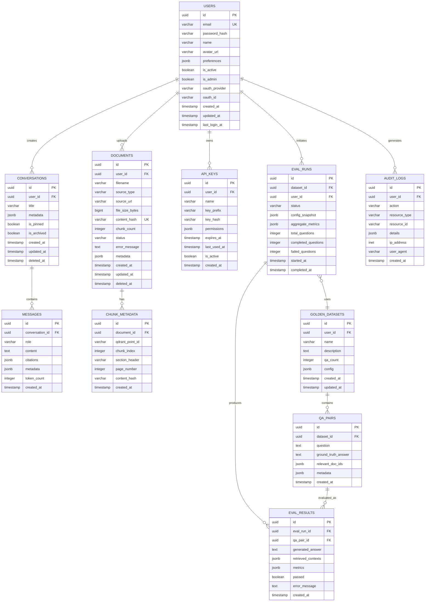

# DeepResearcher - Backend Schema & Data Design

## 1. Data Storage Overview

DeepResearcher uses a **polyglot persistence** architecture with 4 storage systems:

| System | Purpose | Data Types |
|--------|---------|------------|
| **Qdrant** | Vector search (primary) | Document chunks + embeddings + metadata |
| **Redis** | Cache & session | Cached embeddings, retrieval results, LLM responses, rate limits |
| **PostgreSQL** | Relational data | Users, conversations, documents, API keys, eval runs, audit logs |
| **Local FS** | File storage | Uploaded documents, exported conversations, logs |

````txt
┌─────────────────────────────────────────────────────────────────┐
│                      STORAGE ARCHITECTURE                       │
├─────────────────────────────────────────────────────────────────┤
│                                                                  │
│  ┌──────────────┐  ┌──────────────┐  ┌──────────────┐           │
│  │   QDRANT     │  │    REDIS     │  │  POSTGRESQL  │           │
│  │  (Vector DB) │  │   (Cache)    │  │ (Relational) │           │
│  ├──────────────┤  ├──────────────┤  ├──────────────┤           │
│  │ • Chunks     │  │ • Embeddings │  │ • Users      │           │
│  │ • Embeddings │  │ • Retrieval  │  │ • Conversations│          │
│  │ • Metadata   │  │ • LLM Resp   │  │ • Documents  │           │
│  │ • Tenant ID  │  │ • Rate Limit │  │ • API Keys   │           │
│  │ • Sparse     │  │ • Sessions   │  │ • Eval Runs  │           │
│  │   (BM25)     │  │ • Job Status │  │ • Audit Log  │           │
│  └──────────────┘  └──────────────┘  └──────────────┘           │
│                                                                  │
│  ┌──────────────┐                                              │
│  │  LOCAL FS    │                                              │
│  ├──────────────┤                                              │
│  │ • data/docs/ │  ← Raw uploaded files                        │
│  │ • data/eval/ │  ← Golden datasets                           │
│  │ • logs/      │  ← Application logs                          │
│  └──────────────┘                                              │
│                                                                  │
└─────────────────────────────────────────────────────────────────┘
```

---

## 2. Qdrant (Vector Database)

### 2.1 Collection Schema

```json
{
  "collection_name": "documents",
  "vectors": {
    "dense": {
      "size": 1024,
      "distance": "Cosine",
      "on_disk": true
    }
  },
  "sparse_vectors": {
    "bm25": {
      "index": {
        "on_disk": true
      }
    }
  },
  "optimizers_config": {
    "default_segment_number": 2,
    "memmap_threshold": 20000
  },
  "quantization_config": {
    "scalar": {
      "type": "int8",
      "quantile": 0.99,
      "always_ram": true
    }
  },
  "hnsw_config": {
    "m": 16,
    "ef_construct": 100,
    "full_scan_threshold": 10000
  }
}
```

### 2.2 Point Structure (Chunk Document)

```json
{
  "id": "uuid4-string",
  "vector": {
    "dense": [0.123, -0.456, ...],
    "bm25": { "indices": [12, 45, 78], "values": [0.8, 0.6, 0.4] }
  },
  "payload": {
    "chunk_id": "uuid4-string",
    "document_id": "uuid4-string",
    "tenant_id": "uuid4-string",
    "content": "The actual chunk text...",
    "content_hash": "sha256-hash-of-content",
    "chunk_index": 3,
    "chunk_count": 12,
    "document_name": "research-paper.pdf",
    "source_type": "pdf",
    "source_url": "https://...",
    "title": "Introduction to RAG Systems",
    "author": "John Doe",
    "section_header": "2.1 Vector Search",
    "page_number": 5,
    "word_count": 512,
    "tags": ["rag", "embeddings"],
    "created_at": "2026-10-11T10:30:00Z",
    "updated_at": "2026-10-11T10:30:00Z",
    "embedding_model": "BAAI/bge-large-en-v1.5",
    "embedding_dim": 1024,
    "language": "en",
    "custom_metadata": {
      "department": "engineering",
      "confidentiality": "internal"
    }
  }
}
```

### 2.3 Multi-Tenancy Strategy

**Namespace isolation via payload filtering:**

```python
# All queries filter by tenant_id
search_filter = {
    "must": [
        {"key": "tenant_id", "match": {"value": current_tenant_id}}
    ]
}
```

**Alternative: Separate collections per tenant** (for larger tenants):
```
documents_tenant_a
documents_tenant_b
```

**Chosen approach**: Payload filtering (simpler, easier to manage, sufficient for < 100 tenants)

### 2.4 Indexing Strategy

| Field | Index Type | Purpose |
|-------|------------|---------|
| `tenant_id` | Keyword | Tenant isolation filter |
| `document_id` | Keyword | Document-level queries |
| `created_at` | Datetime | Time-based filtering |
| `tags` | Keyword | Tag filtering |
| `source_type` | Keyword | Format filtering |
| `content` | Text | Full-text search (BM25) |

### 2.5 Payload Indexes (Qdrant)

```python
# Create payload indexes for fast filtering
client.create_payload_index(
    collection_name="documents",
    field_name="tenant_id",
    field_schema="keyword"
)
client.create_payload_index(
    collection_name="documents",
    field_name="document_id",
    field_schema="keyword"
)
client.create_payload_index(
    collection_name="documents",
    field_name="created_at",
    field_schema="datetime"
)
```

---

## 3. Redis (Cache & Session Store)

### 3.1 Key Patterns

| Pattern | Example | TTL | Purpose |
|---------|---------|-----|---------|
| `emb:{model}:{hash}` | `emb:bge:sha256abc123` | 7 days | Embedding cache |
| `ret:{hash}` | `ret:sha256def456` | 1 hour | Retrieval result cache |
| `llm:{model}:{hash}` | `llm:70b:sha256ghi789` | 24 hours | LLM response cache |
| `ratelimit:{key}:{window}` | `ratelimit:user_123:1697` | 60s | Rate limiting |
| `session:{jti}` | `session:a1b2c3d4` | 15 min | Active sessions |
| `conv:{conv_id}` | `conv:uuid-1234` | 30 days | Conversation state |
| `job:{job_id}` | `job:celery-task-id` | 24 hours | Ingestion job status |
| `lock:{resource}` | `lock:doc:uuid-5678` | 30s | Distributed locks |

### 3.2 Data Structures

#### Embedding Cache
```json
Key: "emb:bge:sha256abc123"
Value: {"embedding": [0.123, -0.456, ...], "tokens": 42, "model": "bge-large"}
TTL: 604800 (7 days)
```

#### Retrieval Cache
```json
Key: "ret:sha256def456"
Value: {
  "query": "what is RAG?",
  "filters": {"tenant_id": "uuid"},
  "results": [
    {"chunk_id": "uuid", "content": "...", "score": 0.92, "metadata": {...}},
    ...
  ],
  "total": 10,
  "latency_ms": 149
}
TTL: 3600 (1 hour)
```

#### Rate Limiting (Sorted Set)
```
Key: "ratelimit:user_123:1697000000"
ZADD: member=request_uuid, score=timestamp
ZREMRANGEBYSCORE: remove old requests outside window
ZCARD: count current window requests
```

#### Job Status
```json
Key: "job:celery-task-id-12345"
Value: {
  "status": "processing",
  "progress": 0.45,
  "stage": "embedding",
  "document_id": "uuid",
  "error": null,
  "started_at": "2026-10-11T10:30:00Z",
  "updated_at": "2026-10-11T10:30:30Z"
}
TTL: 86400 (1 day)
```

---

## 4. PostgreSQL (Relational Database)

### 4.1 Entity Relationship Diagram



### 4.2 Table Definitions

#### USERS
```sql
CREATE TABLE users (
    id UUID PRIMARY KEY DEFAULT gen_random_uuid(),
    email VARCHAR(255) UNIQUE NOT NULL,
    password_hash VARCHAR(255),  -- NULL for OAuth-only users
    name VARCHAR(255),
    avatar_url TEXT,
    preferences JSONB DEFAULT '{
        "theme": "system",
        "default_model": "llama-3.1-70b-versatile",
        "top_k": 10,
        "temperature": 0.1
    }',
    is_active BOOLEAN DEFAULT true,
    is_admin BOOLEAN DEFAULT false,
    oauth_provider VARCHAR(50),  -- 'google', 'github'
    oauth_id VARCHAR(255),
    created_at TIMESTAMP WITH TIME ZONE DEFAULT NOW(),
    updated_at TIMESTAMP WITH TIME ZONE DEFAULT NOW(),
    last_login_at TIMESTAMP WITH TIME ZONE
);

CREATE INDEX idx_users_email ON users(email);
CREATE INDEX idx_users_oauth ON users(oauth_provider, oauth_id);
```

#### CONVERSATIONS
```sql
CREATE TABLE conversations (
    id UUID PRIMARY KEY DEFAULT gen_random_uuid(),
    user_id UUID NOT NULL REFERENCES users(id) ON DELETE CASCADE,
    title VARCHAR(500),
    metadata JSONB DEFAULT '{}',
    is_pinned BOOLEAN DEFAULT false,
    is_archived BOOLEAN DEFAULT false,
    created_at TIMESTAMP WITH TIME ZONE DEFAULT NOW(),
    updated_at TIMESTAMP WITH TIME ZONE DEFAULT NOW(),
    deleted_at TIMESTAMP WITH TIME ZONE  -- Soft delete
);

CREATE INDEX idx_conversations_user_id ON conversations(user_id);
CREATE INDEX idx_conversations_created_at ON conversations(created_at DESC);
CREATE INDEX idx_conversations_pinned ON conversations(user_id, is_pinned) WHERE is_pinned = true;
```

#### MESSAGES
```sql
CREATE TABLE messages (
    id UUID PRIMARY KEY DEFAULT gen_random_uuid(),
    conversation_id UUID NOT NULL REFERENCES conversations(id) ON DELETE CASCADE,
    role VARCHAR(20) NOT NULL CHECK (role IN ('user', 'assistant', 'system')),
    content TEXT NOT NULL,
    citations JSONB,  -- [{doc_id, chunk_id, content, score}]
    metadata JSONB,   -- {model, tokens, latency_ms, retrieval_count}
    token_count INTEGER,
    created_at TIMESTAMP WITH TIME ZONE DEFAULT NOW()
);

CREATE INDEX idx_messages_conversation_id ON messages(conversation_id, created_at);
```

#### DOCUMENTS
```sql
CREATE TABLE documents (
    id UUID PRIMARY KEY DEFAULT gen_random_uuid(),
    user_id UUID NOT NULL REFERENCES users(id) ON DELETE CASCADE,
    filename VARCHAR(500) NOT NULL,
    source_type VARCHAR(50) NOT NULL,  -- 'pdf', 'markdown', 'txt', 'html', 'youtube'
    source_url TEXT,
    file_size_bytes BIGINT,
    content_hash VARCHAR(64) UNIQUE NOT NULL,  -- Dedup key
    chunk_count INTEGER DEFAULT 0,
    status VARCHAR(50) DEFAULT 'pending',  -- pending, processing, completed, failed
    error_message TEXT,
    metadata JSONB DEFAULT '{}',
    created_at TIMESTAMP WITH TIME ZONE DEFAULT NOW(),
    updated_at TIMESTAMP WITH TIME ZONE DEFAULT NOW(),
    deleted_at TIMESTAMP WITH TIME ZONE
);

CREATE INDEX idx_documents_user_id ON documents(user_id);
CREATE INDEX idx_documents_content_hash ON documents(content_hash);
CREATE INDEX idx_documents_status ON documents(status);
CREATE INDEX idx_documents_created_at ON documents(created_at DESC);
```

#### API_KEYS
```sql
CREATE TABLE api_keys (
    id UUID PRIMARY KEY DEFAULT gen_random_uuid(),
    user_id UUID NOT NULL REFERENCES users(id) ON DELETE CASCADE,
    name VARCHAR(255) NOT NULL,
    key_prefix VARCHAR(10) NOT NULL,  -- First chars for identification: 'dr_abc123'
    key_hash VARCHAR(64) NOT NULL,     -- SHA-256 of full key
    permissions JSONB DEFAULT '["query", "upload"]',
    expires_at TIMESTAMP WITH TIME ZONE,
    last_used_at TIMESTAMP WITH TIME ZONE,
    is_active BOOLEAN DEFAULT true,
    created_at TIMESTAMP WITH TIME ZONE DEFAULT NOW()
);

CREATE INDEX idx_api_keys_user_id ON api_keys(user_id);
CREATE INDEX idx_api_keys_key_hash ON api_keys(key_hash) WHERE is_active = true;
```

#### EVAL_RUNS
```sql
CREATE TABLE eval_runs (
    id UUID PRIMARY KEY DEFAULT gen_random_uuid(),
    dataset_id UUID NOT NULL REFERENCES golden_datasets(id),
    user_id UUID NOT NULL REFERENCES users(id),
    status VARCHAR(50) DEFAULT 'running',  -- running, completed, failed
    config_snapshot JSONB,  -- Model, top_k, temperature at time of run
    aggregate_metrics JSONB, -- {faithfulness, answer_relevancy, ...}
    total_questions INTEGER,
    completed_questions INTEGER DEFAULT 0,
    failed_questions INTEGER DEFAULT 0,
    started_at TIMESTAMP WITH TIME ZONE DEFAULT NOW(),
    completed_at TIMESTAMP WITH TIME ZONE
);

CREATE INDEX idx_eval_runs_dataset_id ON eval_runs(dataset_id);
CREATE INDEX idx_eval_runs_user_id ON eval_runs(user_id);
CREATE INDEX idx_eval_runs_started_at ON eval_runs(started_at DESC);
```

#### AUDIT_LOGS
```sql
CREATE TABLE audit_logs (
    id UUID PRIMARY KEY DEFAULT gen_random_uuid(),
    user_id UUID REFERENCES users(id) ON DELETE SET NULL,
    action VARCHAR(100) NOT NULL,  -- 'login', 'upload', 'query', 'delete'
    resource_type VARCHAR(50),
    resource_id VARCHAR(255),
    details JSONB DEFAULT '{}',
    ip_address INET,
    user_agent TEXT,
    created_at TIMESTAMP WITH TIME ZONE DEFAULT NOW()
);

CREATE INDEX idx_audit_logs_user_id ON audit_logs(user_id, created_at DESC);
CREATE INDEX idx_audit_logs_action ON audit_logs(action, created_at DESC);
-- Partition by month for large deployments
```

---

## 5. Local File Storage

### 5.1 Directory Structure
```
data/
├── docs/                    # Uploaded raw documents
│   └── {tenant_id}/{document_id}/{filename}
├── exports/                 # Conversation exports
│   └── {user_id}/{conversation_id}.json
├── eval/
│   └── golden_set.json      # Evaluation dataset
└── logs/
    ├── app.log              # Application logs
    └── access.log           # HTTP access logs
```

### 5.2 File Naming & Retention
- **Uploaded docs**: Retained until user deletes (configurable TTL)
- **Exports**: Auto-deleted after 7 days
- **Logs**: Rotated daily, retained 30 days

---

## 6. Data Flow Examples

### 6.1 Query Flow (Data Touches)
```
1. User submits query via API
   → PostgreSQL: Verify auth (api_keys/users)
   → Redis: Check rate limit (ZADD/ZCARD)

2. Generate embedding for query
   → Redis: Check embed cache (emb:*)
   → HF API: If cache miss

3. Retrieve relevant chunks
   → Redis: Check retrieval cache (ret:*)
   → Qdrant: Hybrid search (dense + bm25)

4. Rerank results
   → Local bge-reranker model

5. Generate answer
   → Redis: Check LLM cache (llm:*)
   → Groq API: If cache miss

6. Log & persist
   → PostgreSQL: Insert message + citations
   → Redis: Cache results (expiry)
   → Phoenix: Trace span (all steps)
```

### 6.2 Document Ingestion Flow
```
1. Upload file via API
   → Local FS: Save to data/docs/{tenant}/{doc_id}/
   → PostgreSQL: Insert document record (status='pending')

2. Background job (Celery)
   → Redis: Set job status (job:{task_id})
   → Local FS: Read file

3. Parse & chunk
   → Redis: Update job status (stage='chunking')

4. Generate embeddings
   → Redis: Check/cache embeddings
   → HF API: Batch embed chunks

5. Upsert to Qdrant
   → Qdrant: Store points with tenant_id filter
   → PostgreSQL: Update document (status='completed')
   → Redis: Clear document status
```

---

## 7. Migration Strategy

### 7.1 Tool
**Alembic** for PostgreSQL schema versioning:
```bash
# Generate migration
alembic revision --autogenerate -m "add_user_preferences"

# Apply migrations
alembic upgrade head

# Rollback
alembic downgrade -1
```

### 7.2 Qdrant Schema Changes
- Collection schema managed via code (`src/retrieval/setup.py`)
- Run on application startup (idempotent)
- Payload changes are backward-compatible (no migration needed)

### 7.3 Redis
- No schema; keys have TTL
- Safe to flush in development
- Cache invalidation via key deletion on updates

---

## 8. Backup & Recovery

| Data | Backup Method | Frequency | Retention |
|------|---------------|-----------|-----------|
| PostgreSQL | pg_dump to S3 | Daily | 30 days |
| Qdrant | Snapshot API to S3 | Daily | 7 days |
| Local FS | rsync to NAS | Daily | 30 days |
| Redis | No backup (ephemeral cache) | N/A | N/A |

---

## 9. Scaling Considerations

| Concern | Solution |
|---------|----------|
| PostgreSQL connections | PgBouncer (connection pooling) |
| Qdrant performance | Payload indexes + quantization (int8) |
| Redis memory | LRU eviction (256MB maxmemory) |
| Large documents (>50MB) | Reject or chunk before upload |
| Many tenants | Separate collections per tenant (>50) |
| Audit log growth | Monthly table partitioning |

---

*Document Version: 1.0 | Last Updated: 2026-10-11*
